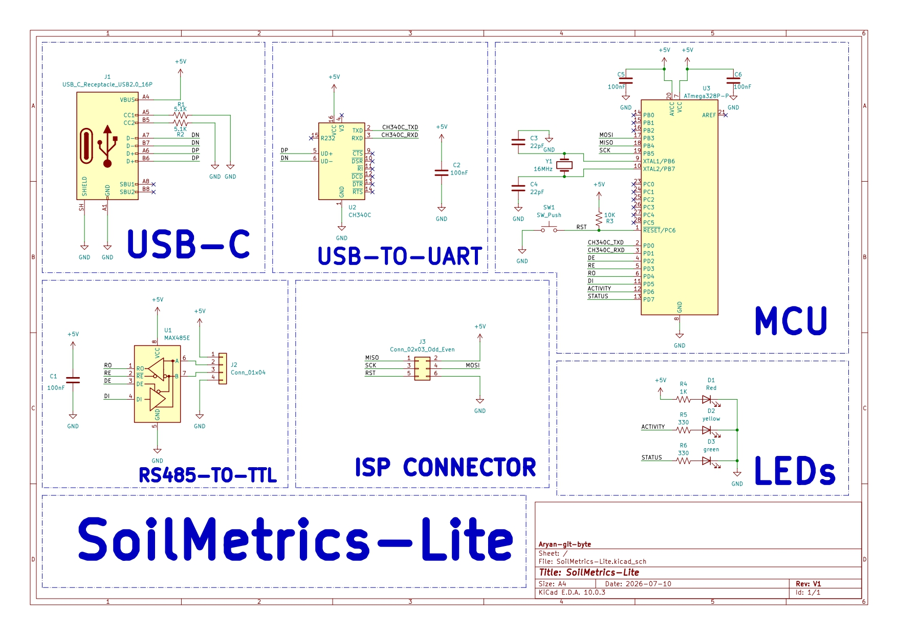
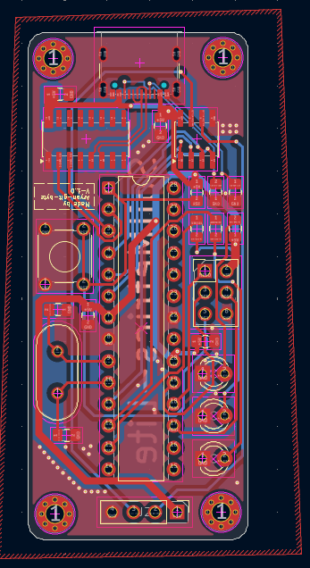
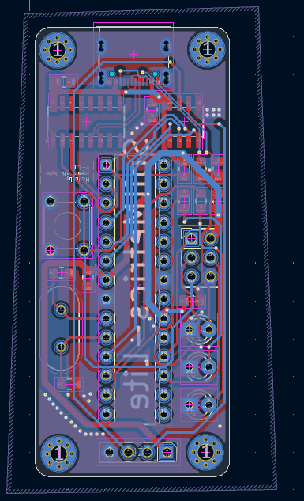
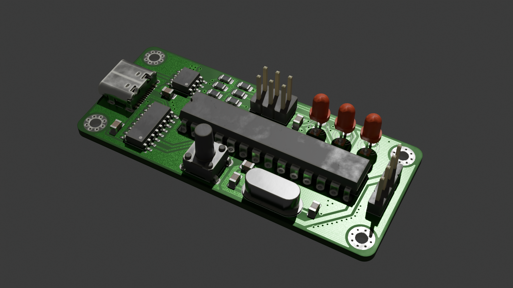
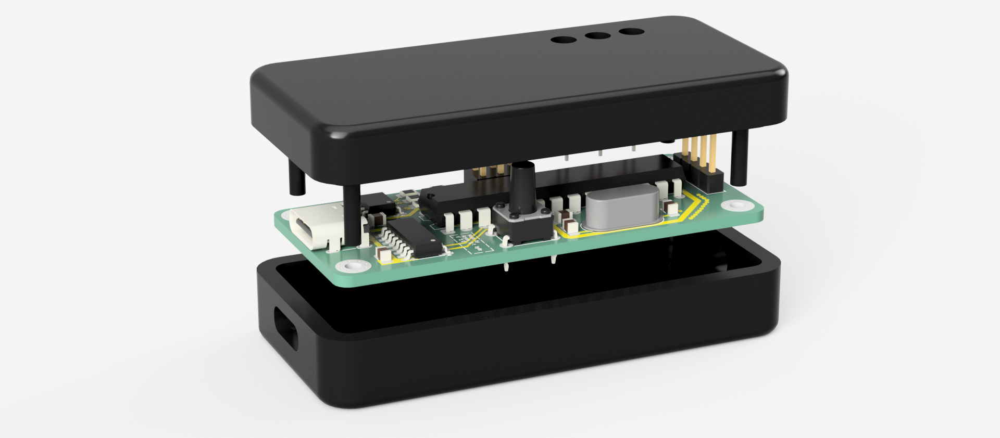

# What is SoilMetric-Lite??
it is a compact soil health monitoring system based on a MAX485 and Atmega328P. its job is to interface the ZTS-3002-TR-ECTHNPKPH-N01 RS485 to a device such as PC, Laptop or phone.
You can even use this board to operate other RS485 based devices.
With the help of this sensor: [ZTS-3002-TR-ECTHNPKPH-N01 RS485](https://robu-prod-media.s3.ap-south-1.amazonaws.com/uploads/2025/04/R224073R224074-ZTS-3002-TR-N01.pdf) it can measure NPK, EC, pH, Temperature and Moisture of the soil.

# Schematic Overview:

Over here, you can see the schematic of the project. The schematic mainly consists of a USB port, a CH340C, a ATMEGA328P and MAX485.
# PCB Overview:
For this project, I used a double layer PCB with a compact layout, which u can see here:

Also heres a cool render of the pcb:

# Case Overview:

The enclosure of this project is designed in fusion 360, the source file of which i have provided in `cad/fusion/` 
The enclosure have 2 parts:
- top body
- bottom body
both of which snaps together easily with pcb in middle.
# Firmware:
It is a simple firmware written in `.ino` which u can upload to the board using ICSP header, but fist you'll have to burn it.
